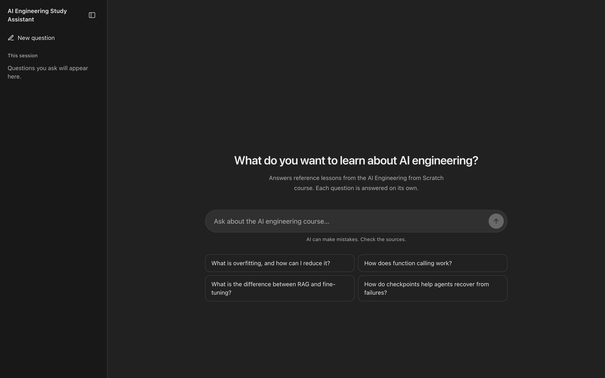
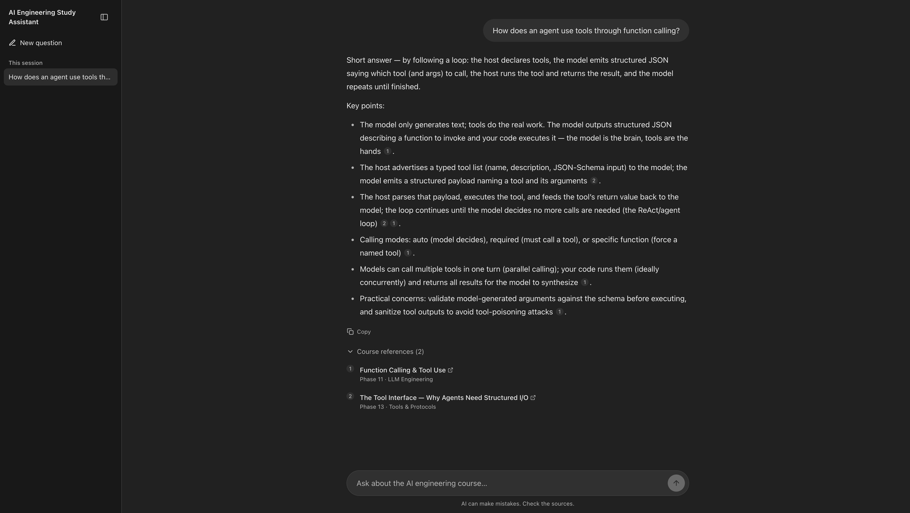

# AI Engineering Study Assistant

Ask questions about the
[AI Engineering from Scratch](https://aiengineeringfromscratch.com/)
course and get streaming answers grounded in its lessons, with links back
to the exact lessons each answer draws on.





## What it does

- **Chat-style study interface.** Ask a question in plain language, or
  start from a suggested question. Questions from the current session are
  listed in a collapsible sidebar (a drawer on mobile).
- **Streaming answers.** Answers appear as they are written, with
  progress such as "Finding relevant lessons…" and "Writing answer…". You
  can stop an answer while it streams and retry after errors.
- **Course references.** Inline citation badges in each answer map to a
  "Course references" list under it. References show the lesson title and
  its place in the course (for example, "Phase 11 · LLM Engineering"), and
  link to the lesson on aiengineeringfromscratch.com.
- **Readable Markdown.** Answers support lists, tables, and code blocks.
  Code blocks have a copy button and scroll horizontally. You can also copy
  a whole answer.
- **Light and dark themes** that follow your system setting.

Each question is answered independently. The assistant does not use
earlier questions as context, and session history is cleared when the page
reloads.

## How it works

```text
Browser ──► Next.js (frontend, :3000)
              │  /api/ask route proxies the request and streams the reply
              ▼
            FastAPI (backend, :8000)
              │  1. embed the question (OpenAI)
              │  2. find the 5 closest course passages (Chroma)
              │  3. generate a grounded answer (OpenAI Responses API)
              ▼
            Server-Sent Events: sources → text deltas → done
```

The browser never talks to FastAPI or OpenAI directly. The OpenAI API key
exists only in the Python backend. The Next.js server reads the backend
address from the server-only `BACKEND_URL` variable.

### Indexing pipeline

Before the assistant can answer questions, the course must be downloaded
and indexed once.

1. **Loading** (`app/load_documents.py`). Reads selected Markdown files
   from `documents/ai-engineering-from-scratch/`:

   ```text
   README.md
   ROADMAP.md
   phases/*/README.md
   phases/*/*/docs/en.md
   ```

   This covers the overview, roadmap, phase overviews, and English lesson
   text. Translations, lesson code, and other repository files are not
   indexed.

2. **Cleanup.** Decorative HTML `<picture>` blocks are removed. Other HTML
   and navigation text remains.

3. **Recursive splitting** (`app/chunk_documents.py`). LangChain's
   `RecursiveCharacterTextSplitter` splits each document with
   `chunk_size=1500` and `chunk_overlap=200`, measured in characters, not
   tokens. Each chunk keeps its source path, its position, and a stable ID:

   ```json
   {
     "source": "phases/11-llm-engineering/09-function-calling/docs/en.md",
     "chunk_index": 0,
     "chunk_id": "phases/11-llm-engineering/09-function-calling/docs/en.md::chunk-0"
   }
   ```

4. **Embeddings** (`app/embed_documents.py`). Chunks are embedded with
   OpenAI `text-embedding-3-small` in batches of 50. The vectors, text,
   and metadata are stored in the Chroma collection
   `ai-engineering-course`. Chunks whose IDs are already stored are
   skipped.

### Answering a question

1. **Retrieval** (`app/retrieval.py`). The question is embedded with the
   same model, and Chroma returns the five nearest passages.
2. **Grounded generation** (`app/generate_answer.py`). The question and
   numbered passages are sent to the model set in `OPENAI_CHAT_MODEL`. The
   instructions tell the model to answer only from the passages, cite them
   as `[1]`, `[2]`, …, say when the evidence is insufficient, and treat
   passages as reference data rather than instructions.
3. **Streaming** (`app/main.py`). FastAPI streams a `sources` event, then
   `delta` text fragments, then `done`. If something fails, it sends an
   `error` event instead.
4. **Display** (`frontend/`). The frontend parses the stream incrementally
   and renders Markdown with raw HTML disabled. It groups retrieved
   passages by lesson, so each lesson gets one reference number. Lesson
   titles come from the course's own headings (stored in
   `frontend/src/features/chat/data/courseTitles.json`), not from the model.
   Links are built only from validated relative course paths. English
   lessons link to `https://aiengineeringfromscratch.com/lesson?path=…`;
   other documents link to the course's GitHub repository.

The instructions encourage grounded answers, but claims and citations are
not checked automatically.

## Tech stack

| Area | Technology |
| --- | --- |
| Frontend | Next.js 16 (App Router), React 19, TypeScript, Tailwind CSS 4 |
| Markdown | react-markdown, remark-gfm |
| Frontend tests | Vitest |
| API | FastAPI (Python 3.12) |
| Answer generation | OpenAI Responses API (model set by `OPENAI_CHAT_MODEL`) |
| Embeddings | OpenAI `text-embedding-3-small` |
| Vector database | Chroma |
| Document splitting | LangChain `RecursiveCharacterTextSplitter` |
| Python dependencies | uv |
| Containers | Docker and Docker Compose (frontend, API, and Chroma) |

## Repository structure

```text
app/                         FastAPI backend and indexing scripts
├── main.py                  API: GET /health, POST /ask
├── load_documents.py        Course file selection and cleanup
├── chunk_documents.py       Recursive splitting and chunk IDs
├── embed_documents.py       Embedding and resumable indexing into Chroma
├── retrieval.py             Question embedding and nearest-passage search
└── generate_answer.py       Grounded answer generation as SSE events

frontend/                    Next.js study assistant
├── src/app/                 Layout, page, and /api/ask proxy route
├── src/features/ask/        SSE parsing, validation, streaming service
├── src/features/chat/       Chat UI, citations, course references
├── src/shared/              Shared buttons, icons, clipboard hook
├── scripts/generate-course-titles.mjs
├── Dockerfile               Frontend image (Next.js standalone server)
└── .env.example

documents/
└── ai-engineering-from-scratch/   Course clone (downloaded separately; ignored by Git)

docs/images/                 README screenshots
Dockerfile                   Backend API image
compose.yaml                 Frontend + API + Chroma services
.env.example                 Backend environment template
pyproject.toml, uv.lock      Python dependencies
```

## Set up your own copy

A fork contains only source code. It does **not** include the original
Docker volume, the embeddings, or any API credentials. You will download
the course, start your own Chroma database, and build your own index.

### Prerequisites

- Git
- Python 3.12 and [uv](https://docs.astral.sh/uv/) (to build the index)
- Docker with Docker Compose (on macOS, start Docker Desktop first)
- Optional, for frontend development outside Docker: Node.js 20.9 or
  later and npm (required by Next.js 16)
- An OpenAI API key with billing enabled and access to the answer model
  you choose

### 1. Clone your fork

```bash
git clone https://github.com/YOUR_USERNAME/ai-engineering-study-assistant.git
cd ai-engineering-study-assistant
```

Replace `YOUR_USERNAME`, and adjust the directory name if you renamed the
fork.

### 2. Configure environment variables

Backend (project root):

```bash
cp .env.example .env
```

```dotenv
OPENAI_API_KEY=your_api_key_here
OPENAI_CHAT_MODEL=gpt-5-mini
```

The frontend needs no environment file when it runs in Docker; Compose
sets `BACKEND_URL` for it. Only if you run the frontend with Node outside
Docker:

```bash
cp frontend/.env.example frontend/.env.local
```

```dotenv
BACKEND_URL=http://127.0.0.1:8000
```

| Variable | File | Purpose |
| --- | --- | --- |
| `OPENAI_API_KEY` | `.env` | OpenAI credentials for embeddings and answers. Backend only. |
| `OPENAI_CHAT_MODEL` | `.env` | Text model used to write answers. Use any model your account can access. |
| `CHROMA_HOST`, `CHROMA_PORT` | Set by Compose | Where the API finds Chroma. Defaults: `localhost` / `8001`. Compose sets `chroma` / `8000`. |
| `BACKEND_URL` | Set by Compose, or `frontend/.env.local` | FastAPI address used by the Next.js server. Compose sets `http://api:8000`. Defaults to `http://127.0.0.1:8000`. |

Never put the OpenAI key in frontend code or in a `NEXT_PUBLIC_` variable.
`.env` and `frontend/.env.local` are ignored by Git; only the
`.env.example` files are committed.

### 3. Install dependencies

```bash
uv sync --locked
```

The frontend's Node dependencies are installed inside its Docker image.
Run `cd frontend && npm install` only for local frontend development.

### 4. Download the course

```bash
mkdir -p documents
git clone --depth 1 \
  https://github.com/rohitg00/ai-engineering-from-scratch.git \
  documents/ai-engineering-from-scratch
```

### 5. Prepare Docker and start the services

`compose.yaml` uses an **external** volume and sets `pull_policy: never`
for Chroma, so Compose will not create the volume or download the image
for you. Do both once per machine:

```bash
docker pull chromadb/chroma:latest
docker volume create course-chroma-data
```

Then start the services:

```bash
docker compose up --build -d
docker compose ps
```

This builds the API image from `Dockerfile` and the frontend image from
`frontend/Dockerfile`, then starts:

| Service | Address on your machine |
| --- | --- |
| Next.js (`frontend`) | `http://localhost:3000` |
| FastAPI (`api`) | `http://localhost:8000` |
| Chroma (`chroma`) | `http://localhost:8001` |

All ports are bound to `127.0.0.1` only. Inside the Compose network the
frontend reaches FastAPI at `http://api:8000`. Chroma stores its data in
the `course-chroma-data` volume, mounted at `/data`. Compose starts each
service after the one it depends on starts, but does not wait for it to
be ready. If the first request fails, wait a moment and retry.

Check Chroma:

```bash
curl http://localhost:8001/api/v2/heartbeat
```

### 6. Build the index

Optionally preview loading and chunking (no API calls):

```bash
uv run python -m app.load_documents
uv run python -m app.chunk_documents
```

Then embed and store the chunks (this calls OpenAI and costs money):

```bash
uv run python -m app.embed_documents
```

The indexer always connects to Chroma at `localhost:8001` (the Compose
port mapping). It does not read `CHROMA_HOST` or `CHROMA_PORT`. One
development run indexed 6,474 chunks. Your count may differ depending on
the course revision.

If indexing is interrupted, run the same command again. Chunks that are
already stored are skipped.

Optionally test retrieval on its own:

```bash
uv run python -m app.retrieval
```

### 7. Open the app

The frontend is already running in Docker. Open
[http://localhost:3000](http://localhost:3000).

After changing frontend code, rebuild its container:

```bash
docker compose up --build -d frontend
```

## Running the frontend without Docker

For hot reload during frontend development, stop the frontend container
and run Next.js with Node (this needs `frontend/.env.local`, see step 2):

```bash
docker compose stop frontend
cd frontend
npm install
npm run dev
```

## Running the backend without Docker

To run FastAPI on your machine with auto-reload while keeping Chroma in
Docker:

```bash
docker compose stop api
docker compose up -d chroma
uv run uvicorn app.main:app --reload --port 8000
```

When you run it outside Compose, the API uses the default
`CHROMA_HOST=localhost` and `CHROMA_PORT=8001`.

After changing backend code, rebuild the container:

```bash
docker compose up --build -d api
```

Other useful commands:

```bash
docker compose logs -f api      # follow API logs (or frontend)
docker compose stop             # stop services
docker compose down             # remove containers and network (volume is kept)
```

### Reusing data from a standalone Chroma container

If you previously ran a standalone container named `course-chroma` on the
same volume, stop it before starting Compose:

```bash
docker stop course-chroma
```

Do not run two Chroma containers against the same volume at the same time.

## Example questions

- What is overfitting, and how can I reduce it?
- How does function calling work?
- What is the difference between RAG and fine-tuning?
- How do checkpoints help agents recover from failures?
- How does an agent use tools through function calling?

## API reference

The frontend calls these endpoints through its `/api/ask` route, but you
can also call FastAPI directly.

### `GET /health`

```bash
curl http://localhost:8000/health
```

```json
{"status":"ok"}
```

This only shows that the API is responding. It does not check OpenAI
access, Chroma, or whether documents are indexed.

### `POST /ask`

```bash
curl -N http://localhost:8000/ask \
  -H "Content-Type: application/json" \
  -d '{"question":"What is overfitting, and how can I reduce it?"}'
```

`-N` turns off curl's buffering so events appear as they arrive. The
question must contain non-whitespace text and be at most 4,000
characters; otherwise the API returns `422`.

The response is `text/event-stream`:

```text
event: sources
data: {"sources":[{"citation":1,"source":"path/to/lesson/docs/en.md","chunk_id":"path/to/lesson/docs/en.md::chunk-0"}]}

event: delta
data: {"text":"Overfitting"}

event: delta
data: {"text":" happens when..."}

event: done
data: {}
```

| Event | Meaning |
| --- | --- |
| `sources` | Retrieved passages and their citation numbers (includes passages the model may not cite) |
| `delta` | A text fragment to append; fragments can split words or citation markers |
| `done` | The answer finished |
| `error` | Processing failed; `data` contains a short `message` |

Errors that happen after streaming starts arrive as `error` events while
the HTTP status stays `200`. If nothing is indexed, the stream contains
only an `error` event with the message "No documents are indexed."

The Next.js route `POST http://localhost:3000/api/ask` accepts the same
body and passes the stream through unchanged. If FastAPI cannot be
reached, it returns `502`.

Interactive API docs are available at
[http://localhost:8000/docs](http://localhost:8000/docs).

## Development checks

From `frontend/`:

```bash
npm run lint
npm run typecheck
npm test
npm run build
```

There are frontend unit tests (SSE parsing, streaming, validation,
citations, course references, links). The Python backend has no automated
tests yet.

If you update the course clone, regenerate lesson titles for course
references:

```bash
cd frontend
npm run generate:titles
```

## Persistence, costs, and index updates

- **Persistence.** The index lives in the local Docker volume
  `course-chroma-data`. Stopping, recreating, or running
  `docker compose down` keeps it. Deleting the volume removes it. Pushing
  to GitHub does not upload embeddings.
- **Costs.** Indexing embeds every chunk once. Each question costs one
  embedding call plus one answer-generation call to the model in
  `OPENAI_CHAT_MODEL`.
- **Resume.** The indexer skips chunk IDs already in Chroma, so you can
  safely rerun an interrupted run.
- **Updates.** Skipping by ID does not detect edited or deleted content.
  If the course or the chunk settings change, existing IDs may point to
  outdated text, and old chunks can remain after a document gets shorter.
  To refresh the index, delete and recreate the volume (or the
  collection), then index again. Do not mix embeddings from different
  models in one collection.

## Known limitations

- No authentication or rate limiting.
- No conversation memory; follow-up questions are not rewritten with
  earlier context.
- Session history lives only in the browser tab and is lost on reload.
- Plain vector search (top 5) without hybrid search or reranking.
- Character-based splitting can cut through tables, diagrams, or code.
- Source cleanup is basic; some HTML and navigation text is indexed.
- Citations are not automatically checked against claims, and answers can
  inherit mistakes from the course material.
- The indexer's Chroma address is hardcoded to `localhost:8001`.
- Index updates do not track content hashes or deleted documents.
- `GET /health` does not check dependencies.
- Docker images use mutable tags (`latest`, `node:24-alpine`). Pin
  versions or digests for reproducible builds.
- No evaluation suite or load testing.

## Troubleshooting

| Issue | What to try |
| --- | --- |
| Cannot connect to the Docker daemon | Start Docker Desktop |
| `external volume "course-chroma-data" not found` | `docker volume create course-chroma-data` |
| Chroma image missing | `docker pull chromadb/chroma:latest` |
| Port already allocated | Stop the other process using port 3000, 8000, or 8001 |
| `Course directory not found` | Clone the course into `documents/ai-engineering-from-scratch` |
| "The study assistant is unavailable right now" | Check `docker compose ps` shows `api` running. Outside Docker, check `BACKEND_URL` in `frontend/.env.local` |
| Port 3000 already in use | Stop a local `npm run dev` before starting the `frontend` container |
| "Couldn't write an answer right now" on every question | Check `docker compose logs api`. If the stream says "No documents are indexed.", run `uv run python -m app.embed_documents` with Chroma running |
| API cannot reach Chroma inside Compose | Compose must set `CHROMA_HOST=chroma` and `CHROMA_PORT=8000` |
| OpenAI request fails | Check your key, billing, model access, and `docker compose logs api` |
| Changed `.env` values are ignored | `docker compose up -d --force-recreate api` |
| Updated course content is not reflected | Rebuild the index (see "Index updates") |

## Attribution

All course content comes from
[AI Engineering from Scratch](https://github.com/rohitg00/ai-engineering-from-scratch)
by Rohit Ghumare, published under the MIT License. Lesson links point to
[aiengineeringfromscratch.com](https://aiengineeringfromscratch.com/).

This is an independent companion app, not an official course product.
Keep the upstream license and attribution when redistributing course
material. This app's own source code does not have a `LICENSE` file yet.
